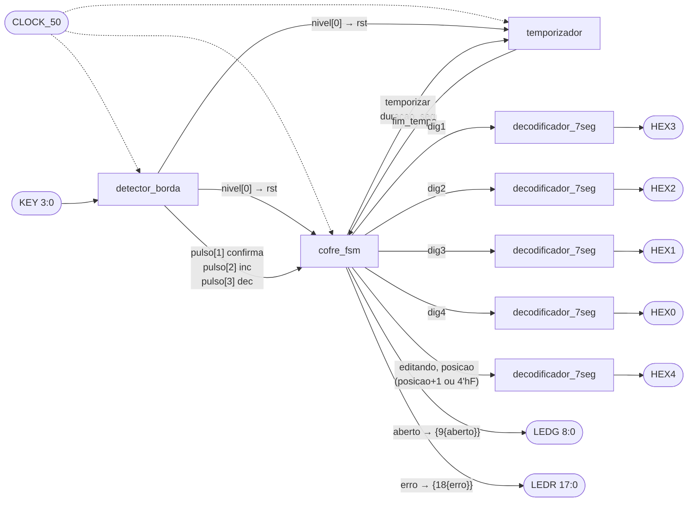
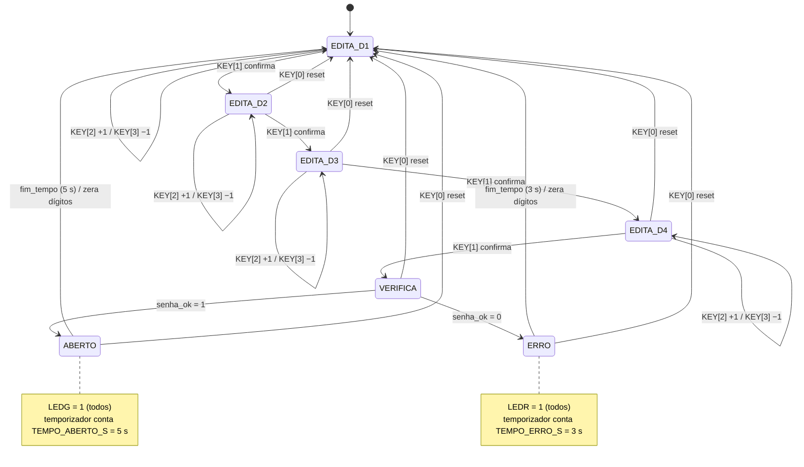
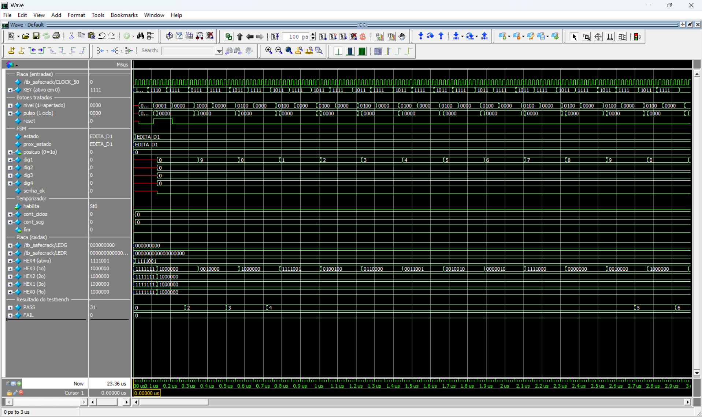
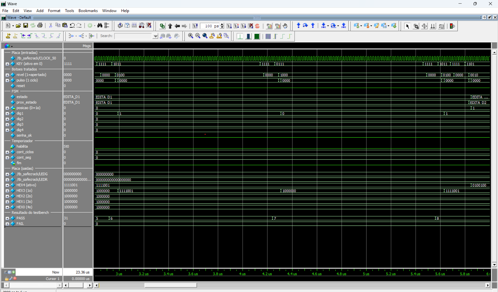
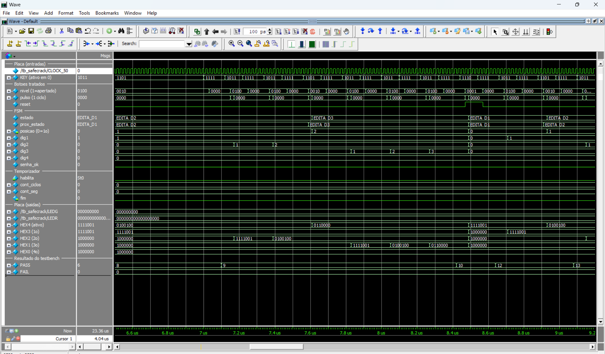
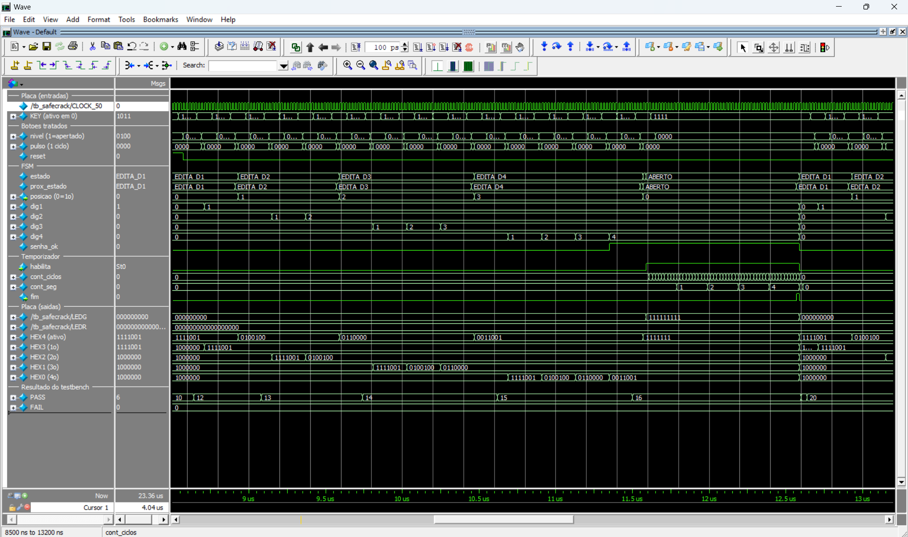
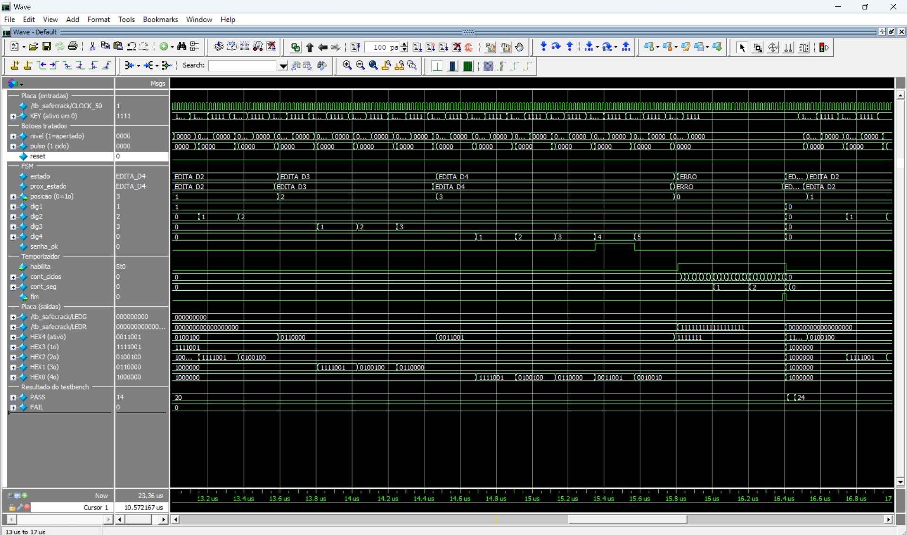

# SafeCrack Pro

Cofre digital com senha de 4 dígitos implementado em SystemVerilog para a placa **DE2-115** (FPGA Cyclone IV E EP4CE115F29C7).

| | |
|---|---|
| **Disciplina** | CIN0130 – Sistemas Digitais |
| **Professor** | Victor Medeiros |
| **Semestre** | 2026.1 |

### Integrantes

| Nome | Parte do código explicada no vídeo |
|---|---|
| <!-- TODO --> | <!-- TODO --> |
| <!-- TODO --> | <!-- TODO --> |
| <!-- TODO --> | <!-- TODO --> |
| <!-- TODO --> | <!-- TODO --> |

---

## 1. Visão geral

O usuário escolhe os 4 dígitos da senha um de cada vez, usando os botões da placa: KEY[2] e KEY[3] mudam o dígito ativo (0 a 9) e KEY[1] confirma e avança para o próximo. Os dígitos aparecem nos displays HEX3 a HEX0, e o HEX4 mostra qual dígito está sendo editado (1 a 4). Depois do 4º dígito, o cofre compara o valor com a senha:

- **senha correta:** todos os LEDs verdes (LEDG) acendem por 5 s;
- **senha errada:** todos os LEDs vermelhos (LEDR) acendem por 3 s.

Em seguida o cofre volta sozinho ao estado inicial. KEY[0] reseta o cofre a qualquer momento.

---

## 2. Como os requisitos foram implementados

| Requisito | Onde está | Como |
|---|---|---|
| Senha de 4 dígitos como parâmetro (padrão 1-2-3-4) | `src/safecrack_top.sv` (`safecrack_top`) e `src/cofre_fsm.sv` (`cofre_fsm`) | Parâmetro `SENHA = 16'h1234`, em BCD: cada dígito hexadecimal é um dígito decimal da senha. O topo repassa o parâmetro para a FSM, que compara `{dig1,dig2,dig3,dig4} == SENHA`. |
| Dígitos em HEX3 (1º) a HEX0 (4º) | `src/safecrack_top.sv` + `src/decodificador_7seg.sv` (`decodificador_7seg`) | Quatro instâncias do decodificador ligam `dig1`→HEX3, `dig2`→HEX2, `dig3`→HEX1 e `dig4`→HEX0. |
| HEX4 mostra o dígito ativo (1 a 4) | `src/safecrack_top.sv` | `valor_hex4 = editando ? posicao + 1 : 4'hF`. O valor `4'hF` deixa o display apagado. |
| Segmentos ativos em nível baixo | `src/decodificador_7seg.sv` | A tabela do `case` usa 0 = segmento aceso, com `seg[0]=a ... seg[6]=g` (mesma ordem de `docs/PINOS_DE2-115.md`). |
| KEY[3] decrementa, KEY[2] incrementa, com wrap-around 9↔0 | `src/cofre_fsm.sv` (bloco `always_ff` dos dígitos) | Altera só `digitos[posicao]`: depois do 9 volta para 0, e antes do 0 vem o 9. |
| KEY[1] confirma e avança; no 4º dígito, verifica | `src/cofre_fsm.sv` (bloco `always_comb` do próximo estado) | EDITA_D1→D2→D3→D4 a cada confirmação; de EDITA_D4 vai para VERIFICA. Só anda para frente. |
| KEY[0] reseta de qualquer estado | `src/safecrack_top.sv` + `src/cofre_fsm.sv` + `src/temporizador.sv` | `rst = botao_nivel[0]` (nível sincronizado do botão). Com `rst = 1`, a FSM vai para EDITA_D1, os dígitos vão para 0 e o temporizador é zerado. O reset é síncrono. |
| Uma ação por aperto (sincronizador de 2 FF + detector de borda) | `src/detector_borda.sv` (`detector_borda`) | `sinc1 → sinc2` é o sincronizador. `pulso = sinc2 & ~anterior` vale 1 só no ciclo em que o botão passa de solto para apertado; segurar o botão não gera novos pulsos. |
| LEDG acesos por 5 s se a senha estiver certa | `src/cofre_fsm.sv` (estado ABERTO) + `src/temporizador.sv` (`temporizador`) + `src/safecrack_top.sv` | Em ABERTO: `aberto = 1`, `temporizar = 1`, `duracao_seg = TEMPO_ABERTO_S` (5). `LEDG = {9{aberto}}`. |
| LEDR acesos por 3 s se a senha estiver errada | mesmos arquivos (estado ERRO) | Em ERRO: `erro = 1`, `duracao_seg = TEMPO_ERRO_S` (3). `LEDR = {18{erro}}`. |
| Retorno ao estado inicial | `src/cofre_fsm.sv` | Quando o temporizador gera `fim_tempo`, a FSM vai de ABERTO/ERRO para EDITA_D1 e o sinal `limpar` zera os 4 dígitos. |
| Temporizador parametrizável | `src/temporizador.sv` | O parâmetro `CICLOS_POR_SEG` vale 50_000_000 na placa e 10 no testbench. |

---

## 3. Arquitetura

| Módulo | Arquivo | Função |
|---|---|---|
| `safecrack_top` | `src/safecrack_top.sv` | Topo. Tem as portas com os nomes dos pinos da placa e só interliga os outros módulos. |
| `detector_borda` | `src/detector_borda.sv` | Para os 4 botões: inverte (1 = apertado), sincroniza com 2 flip-flops e gera um pulso de 1 ciclo por aperto. Também entrega o nível sincronizado, usado como reset. |
| `cofre_fsm` | `src/cofre_fsm.sv` | Máquina de estados (Moore) e registradores dos 4 dígitos. Decide a etapa atual, guarda os dígitos e compara com a senha. |
| `temporizador` | `src/temporizador.sv` | Conta ciclos até 1 s (`tick_1s`) e conta os segundos. Gera `fim` depois de `duracao_seg` segundos enquanto `habilita = 1`. |
| `decodificador_7seg` | `src/decodificador_7seg.sv` | Converte um valor de 0 a 9 no padrão de 7 segmentos (ativo em 0). Valores de 10 a 15 apagam o display. São 5 instâncias, uma por display. |



A FSM segue a separação clássica:

1. um `always_ff` que só guarda o estado atual;
2. um `always_comb` que calcula o próximo estado;
3. um `always_comb` que gera as saídas a partir do estado (máquina de Moore);
4. um `always_ff` separado para os registradores dos dígitos.

O estilo (estados com `typedef enum`, blocos `always_ff`/`always_comb` separados, decodificador escrito com `case`) foi baseado nos códigos de referência do professor (FSM base e conversor BCD → 7 segmentos). Uma diferença: no conversor de referência o bit 6 é o segmento `a`, mas aqui usamos `seg[0] = a` para casar com a ordem dos pinos em `docs/PINOS_DE2-115.md`.

---

## 4. Diagrama de estados

Estados definidos em `cofre_fsm.sv` (`typedef enum logic [2:0]`): `EDITA_D1`, `EDITA_D2`, `EDITA_D3`, `EDITA_D4`, `VERIFICA`, `ABERTO`, `ERRO`. `EDITA_D1` tem código 0, que é o estado em que o cofre liga.



Observações:
- O reset em EDITA_D1 mantém o estado, mas zera os dígitos.
- VERIFICA dura 1 ciclo de clock.
- Em ABERTO e ERRO, KEY[1], KEY[2] e KEY[3] são ignorados.

---

## 5. Simulação

O testbench `sim/tb_safecrack.sv` instancia o `safecrack_top` com `CICLOS_POR_SEG = 10`, para a simulação ser rápida: 5 s = 50 ciclos e 3 s = 30 ciclos. Cada verificação imprime `PASS` ou `FAIL` no Transcript. Os padrões esperados dos displays estão numa tabela própria do testbench, independente do decodificador.

### Como rodar

Na raiz do projeto (ModelSim – Intel FPGA Starter Edition 2020.1, em `C:\intelFPGA\20.1\modelsim_ase\win32aloem`):

```
# com interface gráfica e waveforms (sim/wave.do)
vsim -do sim/simular.do

# só texto (PASS/FAIL)
vsim -c -do "do sim/simular.do; quit -f"

# (opcional) criar/atualizar o projeto .mpf do ModelSim
vsim -do sim/criar_projeto.do
```

### Resultado

```
RESUMO: 31 PASS, 0 FAIL
RESULTADO: TODOS OS TESTES PASSARAM
```

Casos cobertos:
- estado inicial;
- wrap-around 0→9 e 9→0;
- botão segurado por 60 ciclos (KEY[2], KEY[3] e KEY[1] contam uma única ação);
- reset no meio da digitação;
- senha correta (LEDG acesos por exatamente 50 ciclos) com retorno ao estado inicial;
- senha errada 1-2-3-5 e 0-2-3-4 (LEDR acesos por exatamente 30 ciclos) com retorno ao estado inicial;
- botões ignorados com o cofre aberto;
- reset com o cofre aberto.

### Waveforms

Nas imagens, os displays aparecem em binário `{g,f,e,d,c,b,a}`, com 0 = aceso. Por exemplo: `1000000` = 0, `1111001` = 1, `0100100` = 2, `0110000` = 3, `0011001` = 4, `0010010` = 5, `0010000` = 9 e `1111111` = apagado.


*Wrap-around (0 a 3 µs).* Logo após o reset inicial, o 1º dígito (`dig1`/HEX3) está em 0. Um aperto de KEY[3] (KEY = `0111`) leva o dígito a **9** (0→9). Um aperto de KEY[2] (KEY = `1011`) volta para **0** (9→0). Depois, apertos sucessivos de KEY[2] contam 1, 2, …, 9 e, no aperto seguinte, o dígito volta a 0. Cada aperto gera um único pulso em `pulso`, e o estado fica em EDITA_D1 o tempo todo.


*Botão segurado (3 a 6 µs).* KEY[2] fica em 0 por 60 ciclos, mas `nivel[2]` permanece em 1 e `pulso[2]` sobe só uma vez: `dig1` vai de 0 para 1 e para. O mesmo vale para KEY[3] (volta para 0). No fim, KEY[1] também é segurado e a FSM avança só um estado (EDITA_D1 → EDITA_D2, HEX4 passa a mostrar 2).


*Reset no meio da digitação (6,6 a 9,2 µs).* O usuário confirma o 2º dígito (2), passa para EDITA_D3 e ajusta o 3º dígito até 3. Ao apertar KEY[0] (KEY = `1110`), o sinal `reset` sobe, a FSM vai para EDITA_D1 e todos os dígitos voltam a 0 (HEX3..HEX0 = `1000000`, HEX4 = 1).


*Senha correta 1-2-3-4 (8,5 a 13,2 µs).* A FSM passa por EDITA_D1…EDITA_D4 enquanto os dígitos são ajustados. Quando `dig4` chega a 4, `senha_ok` (combinacional) vai a 1. Ao confirmar, a FSM passa por VERIFICA e entra em ABERTO: LEDG = `111111111`, HEX4 apaga e o temporizador é habilitado. `cont_seg` conta 1, 2, 3, 4 e, no fim do 5º segundo, `fim` pulsa: a FSM volta a EDITA_D1, LEDG apaga e os displays voltam a 0.


*Senha errada 1-2-3-5 (13 a 17 µs).* O 4º dígito passa por 4 (`senha_ok` = 1 por um instante) e chega a 5 (`senha_ok` volta a 0). Ao confirmar, a FSM vai para ERRO: LEDR acende inteiro, LEDG continua apagado e o temporizador conta 3 segundos (`cont_seg` = 1, 2). No pulso de `fim`, tudo volta ao estado inicial. `senha_ok` só é usado no estado VERIFICA, por isso o valor dele durante a edição não importa.

---

## 6. Como rodar na placa

Requer Quartus Prime Lite 20.1 com suporte a Cyclone IV.

1. **Criar o projeto** (aplica dispositivo, top-level, arquivos de `src/` e pinos de `docs/PINOS_DE2-115.md`):
   ```
   quartus_sh -t quartus/criar_projeto.tcl
   ```
2. **Compilar**: abra `quartus/safecrack_pro.qpf` no Quartus e use *Processing → Start Compilation*, ou pela linha de comando:
   ```
   cd quartus
   quartus_sh --flow compile safecrack_pro
   ```
   O arquivo gerado é `quartus/output_files/safecrack_pro.sof`.
3. **Gravar**:
   - ligue a DE2-115 ao PC pela porta USB-Blaster e deixe a chave RUN/PROG em **RUN**;
   - abra *Tools → Programmer*, selecione *USB-Blaster* em *Hardware Setup*, adicione o `.sof` e clique em *Start*.
   
   Pela linha de comando:
   ```
   quartus_pgm -m jtag -o "p;output_files/safecrack_pro.sof"
   ```
4. **Testar**: aperte KEY[0], digite 1-2-3-4 com KEY[2]/KEY[3] e KEY[1], e confira os LEDs verdes por 5 s. Depois teste uma senha errada (LEDs vermelhos por 3 s).

### Resultados da compilação (Quartus Prime Lite 20.1.1)

A compilação completa terminou com **0 erros** e gerou `quartus/output_files/safecrack_pro.sof`.

As restrições de timing estão em `quartus/safecrack_pro.sdc`:
- `create_clock` de 20 ns (50 MHz) no pino `CLOCK_50`;
- `derive_clock_uncertainty`;
- `set_false_path` nos botões, que são assíncronos e passam pelo sincronizador;
- `set_false_path` nos LEDs e displays, que são lidos por uma pessoa.

Com isso o Timing Analyzer não acusa mais o *Critical Warning 332148 (Timing requirements not met)* e não há caminhos sem restrição.

**Uso de recursos (EP4CE115F29C7):**

| Recurso | Usado | Disponível |
|---|---|---|
| Elementos lógicos (LEs) | 146 | 114.480 (< 1 %) |
| Funções combinacionais | 140 | 114.480 (< 1 %) |
| Registradores | 70 | 114.480 (< 1 %) |
| Pinos | 67 | 529 (13 %) |
| Bits de memória | 0 | 3.981.312 (0 %) |
| Multiplicadores 9 bits / PLLs | 0 / 0 | 532 / 4 |

**Timing (clock `CLOCK_50`, restrição de 20 ns = 50 MHz):**

| Modelo | Fmax | Setup slack | Hold slack |
|---|---|---|---|
| Slow 1200 mV 85 °C (pior caso) | **118,99 MHz** | **+11,596 ns** | +0,404 ns |
| Slow 1200 mV 0 °C | 128,85 MHz | +12,239 ns | +0,355 ns |
| Fast 1200 mV 0 °C | — | +15,843 ns | +0,183 ns |

Todos os slacks são positivos (TNS = 0). O circuito suporta até cerca de 119 MHz no pior caso, mais que o dobro dos 50 MHz da placa.

### Resultados na placa

---

## 7. Decisões de projeto (pontos ambíguos da especificação)

| Ponto | Decisão |
|---|---|
| O que o HEX4 mostra | De 1 a 4 durante a edição (HEX3 = 1º … HEX0 = 4º). Em VERIFICA, ABERTO e ERRO não há dígito ativo, então o HEX4 fica **apagado**. |
| Displays durante os LEDs | HEX3..HEX0 continuam mostrando a senha digitada e só voltam a 0000 quando o tempo acaba (ou com reset). |
| Botões durante os LEDs | KEY[1], KEY[2] e KEY[3] são **ignorados** em ABERTO e ERRO; só KEY[0] (reset) funciona. |
| Dois botões no mesmo ciclo | Uma ação por vez, com prioridade **confirma > incrementa > decrementa**. Se KEY[1] chegar junto com KEY[2]/KEY[3], o dígito não muda e a FSM avança. |
| Tipo de reset | Síncrono e por nível: vale enquanto KEY[0] estiver apertado, depois de passar pelo sincronizador. |
| Formato da senha | `SENHA = 16'h1234`, em BCD (um dígito hexadecimal por dígito decimal). |
| Debounce | Não há debounce no código: os botões da DE2-115 já têm debounce em hardware (Schmitt trigger) na placa. O código faz apenas a sincronização e a detecção de borda. |
| Duração exata dos LEDs | Exatamente `TEMPO × CICLOS_POR_SEG` ciclos de clock (conferido no testbench). Há alguns ciclos de latência entre o aperto e o início, por causa do sincronizador e do estado VERIFICA. |

---

## 8. Known issues

Não há bugs conhecidos até o momento: todos os 31 testes de simulação passam.

Limitações conhecidas (comportamento correto dentro do uso previsto):
- `duracao_seg` tem 4 bits, então `TEMPO_ABERTO_S` e `TEMPO_ERRO_S` devem estar entre 1 e 15 s. Valores fora dessa faixa são truncados e geram tempos errados: com 0, por exemplo, a conta `duracao_seg - 1` dá 15 e os LEDs ficariam acesos por 16 s.
- A senha precisa ter só dígitos de 0 a 9 em cada posição hexadecimal (por exemplo, `16'h12A4` nunca seria aceita).
- O arquivo `sim/safecrack_pro.mpf` gerado pelo ModelSim guarda caminhos absolutos. Por isso ele não é versionado: basta rodar `sim/criar_projeto.do` de novo em outra máquina ou pasta.

- A compilação no Quartus termina com 7 warnings, nenhum crítico:
  - 4× aviso de número de processadores não definido (`NUM_PARALLEL_PROCESSORS`);
  - 1× aviso de LogicLock indisponível na edição Lite;
  - 1× aviso "Some pins have incomplete I/O assignments" (15714): os `KEY` não têm I/O standard explícito e ficam no padrão do Quartus (2,5 V). O `CLOCK_50` está em 3,3-V LVTTL e os LEDs e displays em 2,5 V;
  - 1× aviso (169177): 1 pino precisa atender aos requisitos Intel para interfaces de 3,3/3,0/2,5 V (AN 447), consequência do `CLOCK_50` em 3,3-V LVTTL.

> **TODO (fase da placa):** registrar aqui qualquer problema encontrado no teste com a DE2-115.

---

## Estrutura do repositório

```
src/                       código SystemVerilog (síntese)
  safecrack_top.sv           topo (pinos da placa)
  detector_borda.sv          sincronizador + detector de borda
  cofre_fsm.sv               FSM + registradores dos dígitos
  temporizador.sv            contagem de segundos
  decodificador_7seg.sv      valor → 7 segmentos
sim/
  tb_safecrack.sv            testbench com PASS/FAIL
  simular.do                 compila, simula e abre waveforms
  wave.do                    sinais da janela Wave
  criar_projeto.do           cria o projeto .mpf do ModelSim
quartus/
  criar_projeto.tcl          cria o projeto Quartus + pinos
  safecrack_pro.qpf/.qsf     projeto Quartus (dispositivo, arquivos, pinos)
  safecrack_pro.sdc          restrições de timing (clock de 50 MHz)
docs/
  PINOS_DE2-115.md           pinos usados
  wave_*.png                 capturas das waveforms
```
